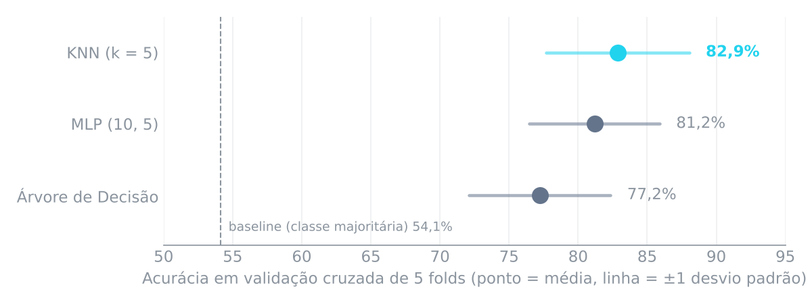
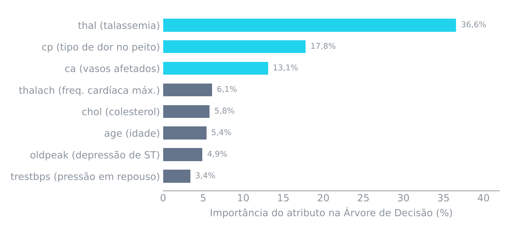

<div align="center">

# 🫀 Previsão de Doença Cardíaca com Machine Learning

**Pipeline completo de ML — da análise exploratória à comparação de modelos — na base Heart Disease (Cleveland, UCI)**


[](https://www.kaggle.com/code/mariaeduardabatt/heart-disease)

</div>

---

## Resultado

O **KNN (k = 5)** alcançou **82,9% de acurácia** e **F1 de 81,0%**, contra **54,1%** do baseline de classe majoritária — um ganho de 28,7 pontos percentuais.

<p align="center">
  
</p>

| Modelo | Acurácia | Precisão | Recall | F1-Score |
|---|---|---|---|---|
| **KNN (k = 5)** | **82,86% ± 5,18** | **82,35%** | 79,92% | **80,97%** |
| MLP (10, 5) | 81,19% ± 4,71 | 79,48% | 79,84% | 79,58% |
| Árvore de Decisão | 77,22% ± 5,13 | 76,16% | 73,39% | 74,63% |
| Baseline (classe majoritária) | 54,13% ± 0,06 | — | — | — |

*Média de validação cruzada estratificada de 5 folds (± desvio padrão entre folds). A classe positiva é "doente".*

**Leitura honesta:** a diferença entre KNN e MLP (1,7 p.p.) é menor que a variação entre folds, então os dois são estatisticamente parecidos nessa base. O KNN foi escolhido por ser mais simples, mais rápido e mais fácil de interpretar. O Leave-One-Out confirmou o resultado do KNN (82,2%), e a diferença entre acurácia de treino e teste ficou abaixo de 2 p.p., sem sinal de overfitting.

---

## O problema

Dado o resultado de 13 exames clínicos de um paciente, prever se ele tem **doença cardíaca** (estenose > 50% em uma artéria coronária).

- **Base:** [Heart Disease — Cleveland](https://archive.ics.uci.edu/dataset/45/heart+disease) (UCI Machine Learning Repository), 303 pacientes, 13 atributos de entrada.
- **Alvo:** o atributo `num` (0 a 4) foi binarizado em **0 = saudável** e **1–4 = doente**, como na literatura (Detrano et al., 1989).
- **Classes:** 164 saudáveis (54,1%) e 139 doentes (45,9%) — relativamente balanceadas, então não foi preciso reamostrar.

---

## Pipeline

```
Dados brutos ──► Análise exploratória ──► Pré-processamento ──► Validação cruzada ──► Modelos ──► Avaliação
 303 × 14        tipos, escalas,          ausentes, outliers,    5 folds estratif.     KNN, MLP,    métricas próprias,
                 estatísticas             normalização           + Leave-One-Out       Árvore       importância
```

### 1. Análise exploratória
- Classificação de cada atributo por **tipo** (quantitativo/qualitativo) e **escala** (nominal, ordinal, intervalar, racional).
- Medidas de **localidade**, **dispersão** e **distribuição** (média, mediana, moda, variância, desvio padrão, coeficiente de variação, quartis e IQR) — todas implementadas à mão, em Python puro.
- Tabelas de frequência dos atributos categóricos.

### 2. Pré-processamento
- **Valores ausentes** (6 no total): `ca` preenchido com a **mediana** (contagem discreta) e `thal` com a **moda** (categórico).
- **Outliers** detectados pela regra de Tukey (1,5 × IQR) e **mantidos**: em dados clínicos, um valor extremo é um paciente real, não um erro.
- **Normalização Min-Max** dos atributos quantitativos, essencial para o KNN, que mede distâncias.
- Verificação de duplicatas e de necessidade de redução de dimensionalidade (303 amostras para 13 atributos: não necessária).

### 3. Modelagem e validação
- **Validação cruzada estratificada de 5 folds**, implementada do zero, mantendo a proporção de classes em cada fold.
- **Leave-One-Out** (303 treinamentos) como validação alternativa para o KNN.
- Modelos do scikit-learn: **KNN**, **MLP** (camadas ocultas 10 e 5) e **Árvore de Decisão**, comparados com um **baseline** de classe majoritária.
- **Matriz de confusão, acurácia, precisão, recall e F1** implementados manualmente.

---

## O que mais pesa no diagnóstico

<p align="center">
  
</p>

Três exames concentram **67,5%** da importância na Árvore de Decisão: **talassemia** (`thal`), **tipo de dor no peito** (`cp`) e **número de vasos afetados** (`ca`). A correlação com o alvo aponta na mesma direção: `thal` (+0,52) e `ca` (+0,46) são os atributos mais associados à doença.

---

## Como executar

```bash
git clone https://github.com/MariaEduardaBatt/heart-disease-ml.git
cd heart-disease-ml
pip install -r requirements.txt
jupyter notebook heart_disease_ml.ipynb
```

O notebook também roda direto no [Kaggle](https://www.kaggle.com/code/mariaeduardabatt/heart-disease), sem instalar nada.

## Estrutura

```
heart-disease-ml/
├── heart_disease_ml.ipynb      # notebook completo, com saídas
├── data/
│   ├── processed.cleveland.data   # base Cleveland (UCI)
│   └── heart-disease.names        # documentação original dos atributos
├── assets/                     # gráficos usados neste README
└── requirements.txt
```

## Próximos passos

- Ajuste de hiperparâmetros com busca em grade (k do KNN, arquitetura do MLP, profundidade da árvore).
- Testar regressão logística e Random Forest, e medir **AUC-ROC**.
- Priorizar **recall** da classe doente: em triagem médica, um falso negativo custa mais que um falso positivo.

---

## Créditos

- **Dados:** Janosi, A., Steinbrunn, W., Pfisterer, M. & Detrano, R. (1988). *Heart Disease* [Dataset]. UCI Machine Learning Repository. [doi:10.24432/C52P4X](https://doi.org/10.24432/C52P4X) — licença CC BY 4.0.
- Projeto desenvolvido na disciplina de Inteligência Artificial do curso de Engenharia de Computação — IFSULDEMINAS, Campus Poços de Caldas (2026).

<div align="center">

Feito por **[Maria Eduarda Batista Henrique](https://github.com/MariaEduardaBatt)** · [LinkedIn](https://www.linkedin.com/in/mariaeduarda-batista/) · [Portfólio](https://mariaeduardabatt.github.io)

</div>
